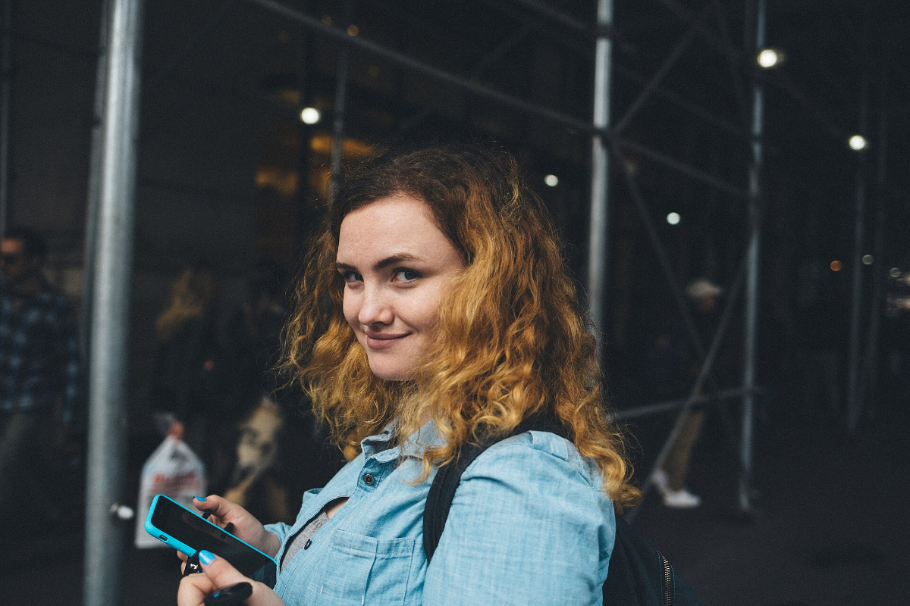
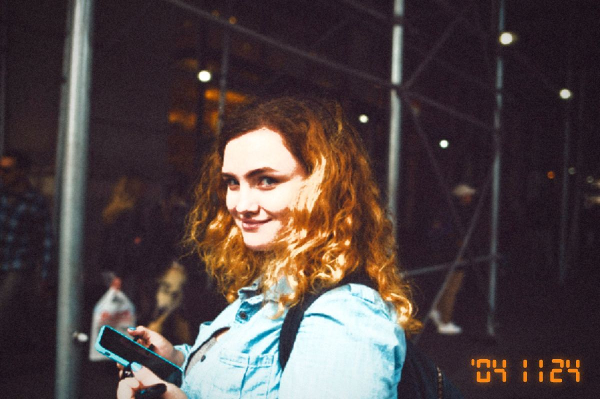
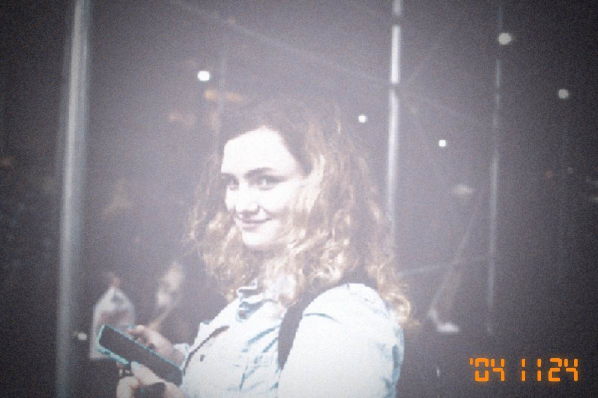
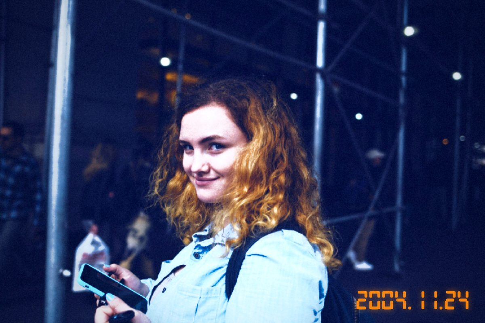
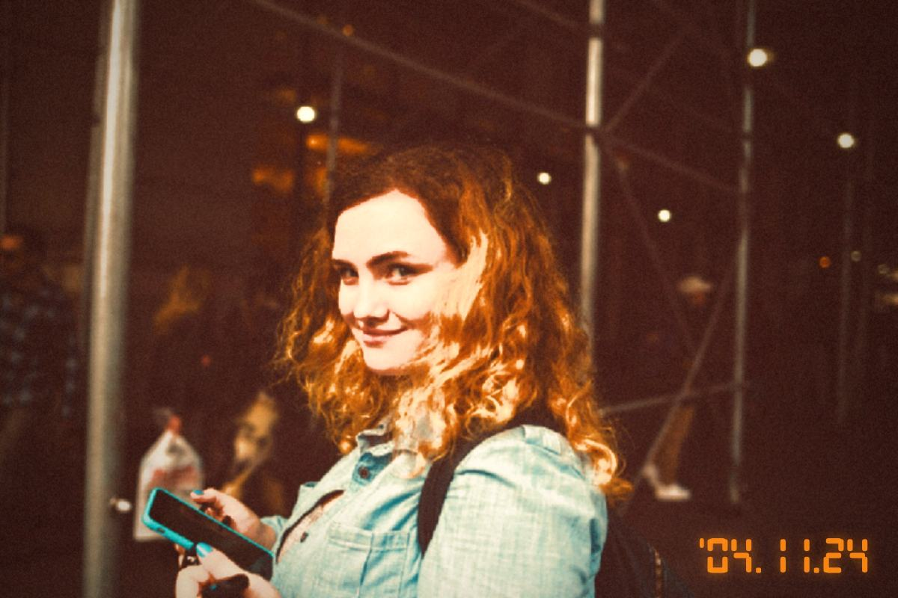
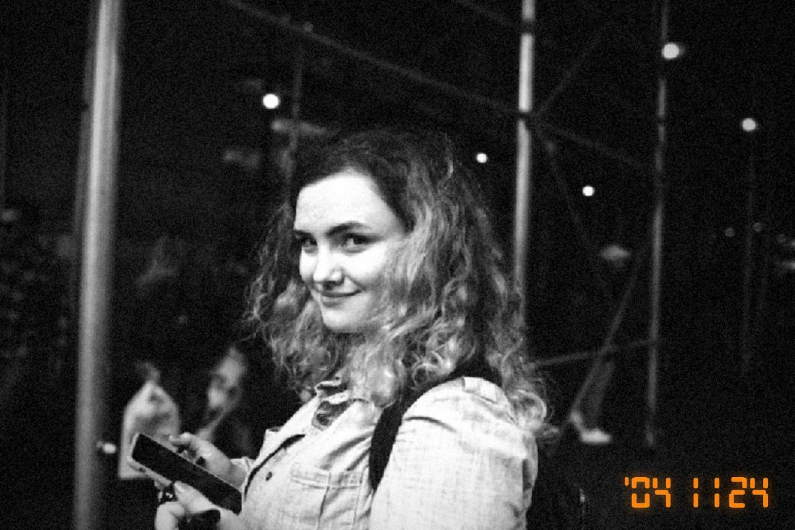
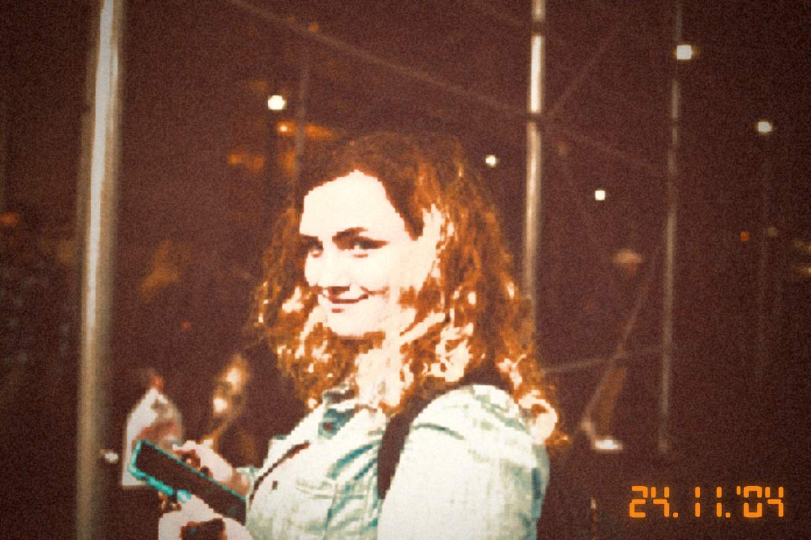

# CCD look

Self-contained early-2000s compact-camera grade for DigiCamSim. It does not
touch screens or navigation. Import it when a capture or export screen is
ready to bake or preview a photo.

The grade is one Skia runtime shader: a slightly smaller sensor, a little
blur, a punchy CCD matrix, highlight clipping, luma grain, chroma noise,
JPEG-ish block loss, an optional vignette, and a direct-flash falloff that
flattens skin. A 7-segment amber date is drawn on top with a blurred pass so
the segments bloom into the photo.

## Version assumptions

- `@shopify/react-native-skia` **2.14.0**, the version in this repo. The same
  calls (`RuntimeEffect.Make`, `makeShaderWithChildren`,
  `Surface.MakeOffscreen` / `Surface.Make`, `encodeToBytes(ImageFormat.JPEG)`,
  and the declarative `Canvas` / `Shader` / `ImageShader` tree) are what the
  web build runs on CanvasKit.
- Web uses `canvaskit-wasm` **0.41.0**, the Skia 2.14 dependency. `index.web.js`
  already calls `LoadSkiaWeb` before the app loads. Bake and preview after
  that promise resolves. If WebGL offscreen surfaces are missing,
  `renderLook` falls back to a CPU surface.
- No extra native modules. String sources may be `file://`, `http(s)`,
  `blob:`, or a `data:` URL. Data URLs are decoded with `Skia.Data.fromBase64`,
  which is how the web camera hands over a picked file.

## Presets

`listPresets()` returns plain objects the UI can render directly:

| id | name |
| --- | --- |
| `ccd-classic` | CCD Classic |
| `night-flash` | Night Flash |
| `cool-cyber` | Cool Cyber |
| `warm-power` | Warm Power |
| `bw-mode` | B&W Mode |
| `indoor-tungsten` | Indoor Tungsten |

`getPreset(id)` and `resolvePreset(id | object)` copy or validate. A custom
object with the same fields is accepted.

## Bake

```ts
import {renderLook} from '@/look';

const jpeg = await renderLook({
  source: image, // SkImage, Uint8Array, or URI
  preset: 'night-flash',
  maxEdge: 1600,
  stamp: {
    clock: {kind: 'fixed', year: 2004, month: 11, day: 24},
    format: 'yy mm dd', // '04 11 24
  },
});

jpeg.bytes; // Uint8Array
jpeg.base64;
jpeg.dataUri; // data:image/jpeg;base64,...
jpeg.stampText; // '04 11 24
```

`renderSkImage(image, options)` is the same bake when the picture is already
decoded. Omit `stamp` for the default: today's month and day, year forced to
2004, format `'yy mm dd'`. Pass `stamp: null` to skip it. Other formats:
`yyyy.mm.dd` (`2004.11.24`), `yy.mm.dd`, `dd.mm.yy`, `mm/dd/yy`.
`clock: {kind: 'current'}` uses the real date. February 29 is kept when the
retro year is a leap year and clamped to the 28th when it is not.

Output is never upscaled. The long edge defaults to 1600. JPEG quality comes
from the preset unless `jpegQuality` is set.

## Live preview

```tsx
import {LookPreview, useLookPreview} from '@/look';

<LookPreview
  source={uri}
  preset="ccd-classic"
  width={width}
  height={height}
  fit="cover"
/>;
```

`useLookPreview` returns the compiled effect, uniforms, and stamp plan if you
draw your own canvas. `fit="contain"` letterboxes and keeps the stamp on the
photo. Grain is stable for a preset unless you pass `seed`.

## Samples

Rendered with CanvasKit 0.41.0 from a CC0 portrait
([Outdoor portrait, Anthony Ginsbrook](https://commons.wikimedia.org/wiki/File:Outdoor_portrait_(Unsplash).jpg),
Wikimedia Commons). The "after" files are the baked JPEG decoded back to PNG,
so the block loss is the real encoder plus the shader.








